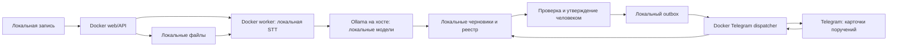

# ADR-0001: Docker-приложение, Ollama на хосте, локальная обработка

Дата: 2026-10-08.
Статус: принято по требованиям владельца; API, PostgreSQL и GPU worker large-v3 развёрнуты на сервере. Доступ Docker → Ollama и CUDA STT проверены. Полный цикл на записи и Telegram ещё не проверены.
Проект: [psptm_minutes](https://github.com/b0ver/psptm_minutes).
Основание: [обследование хоста](../reports/host-assessment-2026-10-08.md).

## Контекст

На хосте 192.168.1.90 уже работают Docker, несколько приложений и Ollama как systemd-служба. Модели расположены в /mnt/models/ollama. Есть RTX 4090 с примерно 24 GiB VRAM. Каталог Ollama содержит локальные веса и облачную ссылку glm-5.1:cloud. Репозиторий проекта пока пустой.

Требования владельца: приложение разрабатывается и запускается в Docker; существующая Ollama остаётся на хосте; записи и AI-обработка локальные; поручения доступны в Telegram и внутреннем реестре. Первоначальный этап ограничивался обследованием. После подготовки локального MVP владелец разрешил развёртывание нового проекта и проверку соединения с Ollama.

## Решение

### Исполнение и хранение

Разработка, тестирование, обработка записей и эксплуатация приложения выполняются через Docker/Compose. Dev и production используют один Dockerfile с отдельными целями/профилями; версии базовых образов и зависимостей фиксируются. На хост не устанавливается runtime приложения.

Предлагаемые логические компоненты:
- web/API: локальная загрузка записи, просмотр протокола и внутреннего реестра;
- worker: локальное распознавание, подготовка протокола, извлечение кандидатов поручений;
- PostgreSQL: внутренний реестр, задания обработки и outbox доставки;
- Telegram dispatcher: доставка утверждённых поручений и обработка разрешённых ответов.

Это границы компонентов, а не утверждённое количество контейнеров. Выбор языка, фреймворка и STT-модели — последующие решения.

Аудио/видео, промежуточные файлы, транскрипты, протоколы, модели STT, база данных и резервные копии сохраняются на локальных томах. Они исключаются из Git и Docker build context. Каталоги приложения отделены от существующих проектов и /mnt/models/ollama. Место, UID/GID, права, сроки хранения и восстановление резервных копий определяются до эксплуатации.

Контейнеры работают без privileged и Docker socket, по возможности от непривилегированного пользователя. Для CPU/RAM задаются ограничения после измерения. Доступ к GPU получает только компонент, которому он нужен. Новая база не публикует порт наружу.

### Ollama остаётся на хосте

Compose не создаёт сервер Ollama, не переносит её веса и не управляет её службой. Приложение обращается напрямую к существующему API. В своей bridge-сети задаётся:

```yaml
# Фрагмент будущей конфигурации AI worker; сейчас не применён.
extra_hosts:
  - "host.docker.internal:host-gateway"
environment:
  OLLAMA_BASE_URL: "http://host.docker.internal:11434"
```

Подстановка host-gateway поддерживается [Docker Engine](https://docs.docker.com/reference/cli/dockerd/#configure-host-gateway-ip); extra_hosts задаёт запись в hosts контейнера в [Compose](https://docs.docker.com/reference/compose-file/services/#extra_hosts). Нынешний OLLAMA_HOST=0.0.0.0:11434 допускает такой маршрут на уровне bind; firewall и доступ из будущей сети ещё нужно проверить.

127.0.0.1 внутри обычного bridge-контейнера относится к самому контейнеру. network_mode: host не используется: он разделяет сетевое пространство хоста и уменьшает изоляцию ([Docker host networking](https://docs.docker.com/engine/network/drivers/host/)). Существующий socat-контейнер ollama не становится зависимостью проекта.

Адрес AI API фиксируется конфигурацией администратора, без пользовательского выбора произвольного URL и без HTTP-прокси для локальных запросов. Ошибка Ollama останавливает задачу или переводит её в ограниченный повтор; перехода на облачный провайдер нет.

### Только локальная AI-обработка

STT выполняется локально, с заранее подготовленными весами и без автоматической загрузки в момент обработки. Ollama выполняет локальное создание протокола и извлечение поручений. При необходимости embeddings тоже локальные. Общий LiteLLM не используется без отдельной проверки маршрутов.

Приложение принимает только модели из явного allowlist с закреплённым digest. Перед задачей сверяется каталог: отсутствие remote_host/remote_model, наличие локальной модели и соответствие digest. Суффикс :cloud запрещён дополнительно; одного фильтра по названию недостаточно. При несовпадении задача прекращается. Нельзя передавать model или провайдера из произвольного пользовательского ввода.

Облачная glm-5.1:cloud исключается из проекта, но не удаляется из существующей Ollama. По [документации Ollama](https://docs.ollama.com/faq) локальный режим и cloud-модели имеют разные маршруты обработки; настройка OLLAMA_NO_CLOUD требует изменения и перезапуска службы. Её применение к общему хосту требует отдельного согласования с владельцами других приложений и не входит в это решение.

На уровне будущей эксплуатации доступ AI worker ограничивается локальными адресами/нужными портами. Поскольку сама Ollama находится вне контейнеров, firewall worker не ограничивает её собственный egress: закрепление локальных моделей обязательно; системное отключение cloud или ограничение исходящих запросов Ollama — отдельное изменение с анализом влияния. До проверки нельзя утверждать, что весь существующий сервер работает без внешних AI-вызовов.

Первый allowlist и размеры контекста выбираются по офлайн-проверке качества на русскоязычной записи. Кандидаты из имеющегося каталога: qwen3.5:9b и qwen2.5:14b-instruct; это варианты для оценки, не подтверждённый выбор модели. Инференс в обследовании не запускался.

Проект обрабатывает одну AI-задачу за раз, с таймаутами и ограниченными повторами. Длинные записи разбиваются на сегменты с сохранением временных меток и ссылок на источник. STT и LLM координируются в пределах проекта; это не ограничивает другие приложения на общей GPU. Размер весов не равен VRAM; контекст и параллельность требуют дополнительной памяти ([Ollama FAQ](https://docs.ollama.com/faq)).

### Telegram и внутренний реестр

Внутренний реестр — источник истины. Поручение содержит ID, встречу/источник и таймкод, текст, ответственного, срок и часовой пояс, статус, версию и журнал изменений. Неустановленные ответственный и срок остаются пустыми до подтверждения; AI не придумывает их.

AI создаёт кандидаты. Пользователь проверяет протокол и утверждает поручения до внешней доставки. В одной локальной транзакции фиксируются поручение и outbox; dispatcher отправляет уведомление и сохраняет результат доставки. Повторы используют стабильный ID поручения и версии; после неоднозначного сетевого таймаута возможен дубль Telegram-сообщения, поэтому абсолютная exactly-once доставка не обещается.

Telegram получает только утверждённую карточку поручения: ID, необходимый текст, ответственный, срок и статус, при необходимости ссылку на внутренний реестр. Аудио/видео, транскрипты, промпты и полные протоколы в Telegram не отправляются. Записи загружаются через локальный web-интерфейс или локальную папку, а не через Telegram.

Telegram — внешняя система доставки. Требование «все записи и AI локальные» допускает передачу утверждённых поручений в этот канал, но не означает, что Telegram хранит их локально. Для строго локального канала вместо Telegram потребуется другое отдельное решение.

Dispatcher использует Telegram Bot API напрямую и отдельные разрешённые чаты/пользователей. Входящие команды сопоставляются с правами внутреннего реестра. Ответы Telegram обновляют локальные статусы с аудитом; доставка и выполнение поручения — разные статусы. При недоступности Telegram локальный реестр сохраняет работу, outbox ожидает повтор. Long polling позволяет избежать публичного webhook на первом этапе.

Токен бота и реквизиты базы передаются через runtime secrets/локальные файлы с ограниченными правами. Их нельзя включать в репозиторий, образ или журналы. Логи не содержат текст записей/промптов, полный URL Bot API с токеном и секреты.

## Поток данных



Стрелка к Telegram — единственная предусмотренная передача содержимого за локальную границу, и только для утверждённых поручений.

## Альтернативы

| Вариант | Решение и причина |
|---|---|
| Ollama в новом Docker-контейнере | Отклонён: противоречит требованию сохранить службу на хосте, дублирует управление весами |
| Приложение непосредственно на хосте | Отклонён: противоречит Docker-разработке и запуску |
| Cloud STT/LLM, включая cloud-теги Ollama | Отклонён: записи и AI-обработка должны оставаться локальными |
| Telegram как единственный реестр | Отклонён: необходим локальный источник истины, аудит и работа при сбое доставки |
| Подключение к общим базам/AI gateway без проверки | Отклонён: чужие данные, маршруты и жизненный цикл не исследованы |

## Последствия

Образы и Compose обеспечивают воспроизводимое окружение; Ollama остаётся общей внешней зависимостью приложения. Обновление Ollama и изменения моделей могут влиять на проект, поэтому необходимы проверки версии API и digest. Общая GPU ограничивает конкурентность; SLA и скорость по этому обследованию не установлены.

Локальное хранение требует резервного копирования, политики доступа и удаления записей. Отправка поручений в Telegram требует минимизации данных и прав. Разделение worker и dispatcher позволяет ограничивать сеть AI-компонентов без нарушения доставки поручений.

## Проверки перед первым разрешённым запуском

1. Зафиксировать образы, зависимости, веса STT и allowlist/digest LLM; подготовить их до обработки реальных записей.
2. Проверить Compose, права на локальные каталоги, свободные порты, резервные копии и отдельные сети/тома.
3. Из worker проверить GET API существующей Ollama; не изменять Ollama и чужие контейнеры.
4. На разрешённой тестовой записи подтвердить локальную STT/LLM, отсутствие внешнего AI-трафика, качество русского текста, VRAM, время обработки и поведение при сбое.
5. Проверить отказ cloud-моделей/неизвестного digest и отсутствие автоматического cloud fallback.
6. Проверить утверждение поручений, outbox/retry, права команд Telegram и локальный аудит.
7. Убедиться, что Telegram получает только утверждённые карточки и не получает записи, транскрипты или протоколы.

Существующие службы не изменялись. Новый API/web и PostgreSQL-реестр запущены на сервере; по последующему указанию владельца включён GPU worker с имеющейся large-v3. GET-проверка подтвердила доступ к существующей Ollama и локальный digest qwen3.5:9b. После GPU-изменений прошли 34 теста на linux/amd64; настоящие CUDA-вычисления float16 проверены на синтетической тишине. Модель STT монтируется только для чтения и выгружается перед обращением к Ollama, CPU fallback отсутствует. Telegram не включён. Сетевые ограничения egress, качество и время полного цикла на записи остаются задачами следующего этапа. [Развёртывание](../deployment-2026-10-08.md) · [GPU STT](../gpu-stt-2026-10-08.md).
